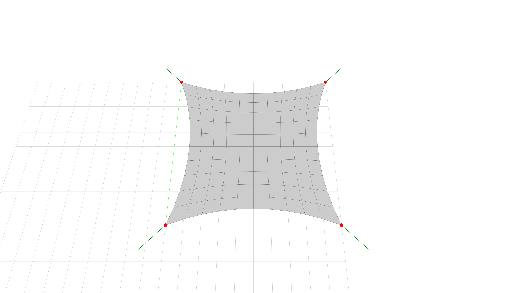
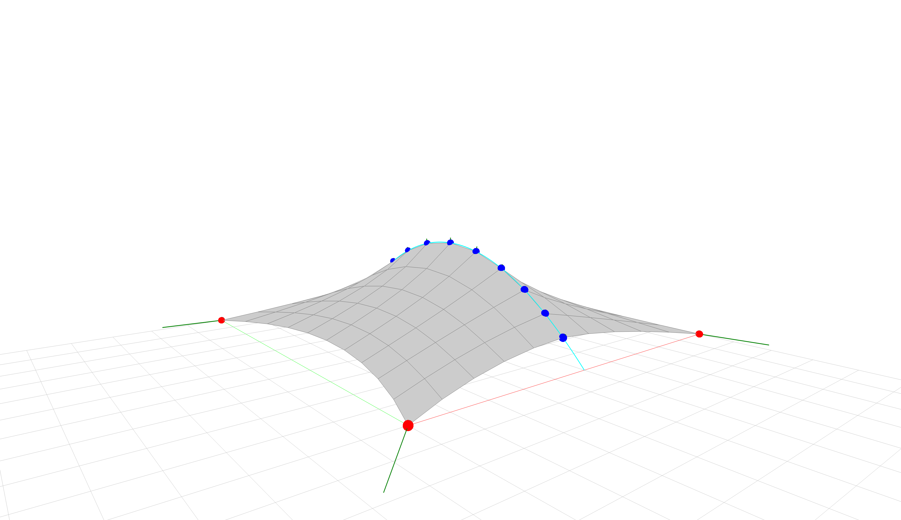

# Worked examples

## Loaded network

Two fixed vertices sit at `(0, 0, 0)` and `(4, 0, 0)`. Their edges to the free
vertex have force densities 1 and 3. Balancing a downward load of 4 gives the
free vertex at `(3, 0, -1)`.

```python
--8<-- "docs/examples/loaded_network.py"
```

## Support illustrations

These illustrations are from earlier COMPAS 2 viewer runs. They show a mesh
with fixed corners and a mesh with sliding supports along a NURBS arch.



